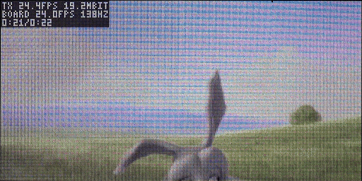
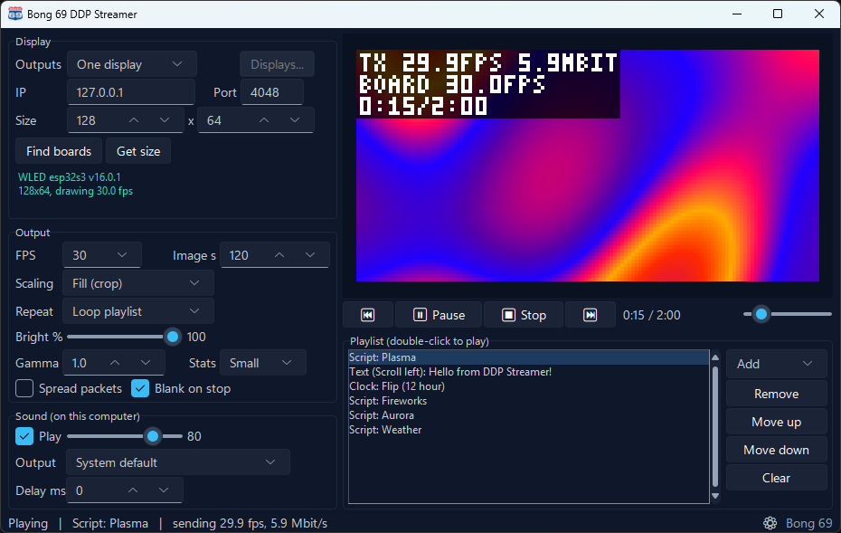
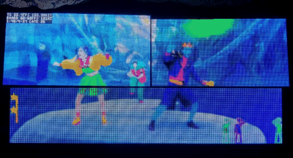
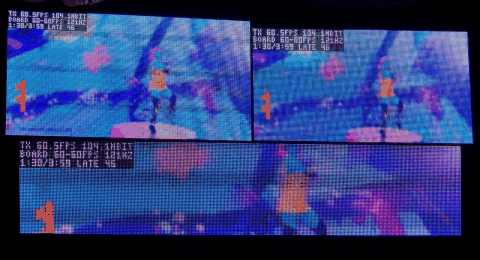

# Bong 69 DDP Streamer

Put videos, pictures, your screen, a camera, text, clocks and animations on
an LED matrix: a WLED panel, or anything else that speaks DDP. Free and open
source.



<sub>A 256x128 wall of eight 64x64 panels, stats overlay on. Video: Big Buck
Bunny (c) Blender Foundation | peach.blender.org, CC BY 3.0.</sub>

## What it does

- **Plays almost anything:** video files (with sound on this computer, kept
  in sync), pictures, the whole screen or one window, USB and built-in
  cameras, scrolling or animated text, clocks with animated digits.
- **Scripts:** 27 ready-made animations (fire, plasma, aurora, fireworks,
  starfield, game of life...) and live data (weather, stock and crypto
  prices, YouTube subscribers, news headlines, a Counter-Strike 2 HUD). Or
  write your own in a few lines of Python with a live preview.
- **Playlist:** mix all of the above, loop it, and start it automatically
  with Windows, so the wall comes back by itself after a power cut. A
  **schedule** plays it between set times on chosen days.
- **Several displays:** show the same picture on all of them (Mirror), or
  join them into one big picture (Span). Different kinds of displays can
  be mixed: give each its pixel pitch (P2, P2.5, P3...) and Span lines them
  up by real size, with gaps between them if they have any.
- **Matching displays:** brightness and color balance per display, with a
  test pattern to set them by eye.
- **Runs unattended:** if a video or script fails, it moves on to the next
  item instead of stopping, and notes it in a log.
- **Finds your displays:** Find boards lists the WLED and DDP devices on
  your network, and Get size reads each one's panel size.
- **Stats overlay:** frames sent, frames the display really draws, data
  rate. Handy when you tune a big wall.



## Download

Get it from the [Releases](../../releases) page. It's free, and nothing
else needs to be installed.

### Windows 10 / 11

Download `DDP-Streamer-setup.exe` and run it. It installs for your user
only (no admin rights needed) and adds DDP Streamer to the Start menu.

Prefer no install? Download `DDP-Streamer-windows.zip` instead, unzip it
anywhere (extract it first, don't run it from inside the zip), and run
`DDP Streamer.exe`.

Windows may warn about an unknown app the first time. Click *More info >
Run anyway*.

### Mac

- **Apple Silicon (M1 and newer), macOS 14 or newer:**
  `DDP-Streamer-mac-apple-silicon.dmg`
- **Intel Macs, macOS 13 or newer:** `DDP-Streamer-mac-intel.dmg`

Not sure which? Apple menu > *About This Mac*: "Chip: Apple M..." is Apple
Silicon, "Processor: Intel" is Intel.

Open the `.dmg` and drag DDP Streamer to Applications. The app isn't from
the App Store, so the first time macOS refuses to open it: open *System
Settings > Privacy & Security*, scroll down to the message about DDP
Streamer and click *Open Anyway*. After that it opens normally.

macOS then asks once to let DDP Streamer find devices on your local
network: click *Allow* (it can't reach your display otherwise). Screen
capture and cameras ask for their own permission the first time you use
them.

### Linux (x86-64, Ubuntu 22.04 or newer and similar)

- **`DDP-Streamer-x86_64.AppImage`**: one file. Make it executable (file
  properties, or `chmod +x DDP-Streamer-x86_64.AppImage`) and double-click
  it.
- **`DDP-Streamer-linux.tar.gz`**: unpack it where you want to keep it,
  then run `./install.sh` in that folder to add DDP Streamer to the
  applications menu (`./install.sh --uninstall` removes it again).

Screen capture on Linux needs an X11 session. On Ubuntu, click the gear icon
on the login screen and pick "Ubuntu on Xorg".

### What works where

Everything works on all three, except: screen capture on Mac and Linux
takes the whole main screen (single windows are Windows-only for now), and
"Open when Windows starts" is Windows-only.

## Quick start with WLED

1. In WLED, set up your panel: *Settings > LED Preferences* (HUB75 or LED
   strip output) and, for strips, *Settings > 2D Configuration*.
2. Open DDP Streamer, click **Find boards** (or type the board's IP
   address) and click **Get size**.
3. Click **Add**, pick a video, a script or some text, and press **Play**.

WLED accepts DDP on its own; nothing to turn on. If the status line under
Display turns red with a *realtime override* warning, WLED has been told to
ignore streams. Turn realtime override off in WLED, or reboot the board.

Tested with WLED on the Waveshare ESP32-S3-RGB-Matrix, the Adafruit Matrix
Portal S3 and the Apollo M-1. Other WLED boards and DDP devices should work
too.

## Run from source

Python 3.10 or newer:

```
pip install -r requirements.txt
python ddp_streamer.py
```

Linux also needs Tk and PortAudio: `sudo apt install python3-tk libportaudio2`.
On a Mac, use Python from python.org (Apple's own Python is too old). Intel
Macs also need `pip install --no-deps "opencv-python>=4.8,<4.13"` (newer
OpenCV versions need macOS 14).

## Using it

1. **Display:** type the display's IP address and click **Get size**, or
   click **Find boards**.
2. **Playlist:** click **Add** and choose what to show, or drag files onto
   `DDP Streamer.exe`. Double-click an item to play it; right-click for Play, Edit,
   Rotate / crop and Remove.
   - **Video or image files...**
   - **Screen or window...** the main screen, or one window (a video
     player, a web page, a game). A window is captured even when other
     windows cover it, but not while it's minimized. Single windows:
     Windows only; Linux (X11) and Mac capture the main screen.
   - **Camera...** shows a snapshot from each camera it finds, including
     virtual cameras such as OBS's (on Windows: start OBS's Virtual Camera
     first). **Mirror** flips it like a selfie. An unplugged or busy camera
     shows black until it is back.
   - **Text...** in any color, size and font, with an **Effect**: Auto,
     Scroll left, Scroll up, Fit, Wave, Bounce, Typewriter, Blink, Pulse or
     Zoom.
   - **Clock...** 24 or 12 hour, Plain or an animated look: Code Rain,
     Fire, Block Drop, Flip, Shatter, Neon or 7-Segment.
   - **Script...** pick an example, set its sliders and colors while the
     preview runs, or write your own (**New script...**, **Edit code**).
     Every save shows up on the wall at once. The scripting manual is in
     `docs/scripting.html` (or **Manual** in the Script window).

   Pictures, screens, text, clocks and scripts show for **Image s**
   seconds; set **Repeat** to **Loop current** to keep one on the wall.

   **Rotate / crop...** (right-click any item) turns it 90° or 180° (a phone
   video filling a wall sideways, a display mounted on its side) and can
   show just part of it: drag a box over the picture, scroll to zoom. The
   wall follows while you adjust.
3. **Output:**
   - **FPS:** pick 15-60 or type any rate. Matching the video (often 24, 30
     or 60) gives the smoothest motion.
   - **Scaling:** Fill crops to the display shape, Fit adds black bars,
     Stretch distorts.
   - **Brightness and Gamma** change the picture before it is sent.
   - **Stats:** Off, Small or Large overlay in the top-left corner.
4. **Sound:** pick the output device. If the picture runs ahead of the
   sound (Bluetooth headphones, for example), raise **Sound delay**.
5. **Running on its own:** the ⚙ in the bottom right has **Play the
   playlist when opened**, **Open when Windows starts** and **Schedule...**:
   a start and stop time (24-hour; a stop before the start runs past
   midnight) and the days. At the start the playlist plays, at the stop it
   stops and the displays go dark; you can still play or stop by hand in
   between. If an item fails or stops sending for 15 s, the streamer
   restarts it or moves on, and the status line counts these recoveries
   (details in `streamer.log`, next to the settings).

### Several displays

Set **Outputs** to **Mirror** (every display shows the whole picture) or
**Span** (the displays join into one big picture, e.g. two 128x64 panels
side by side make 256x64). Click **Displays...** to list them, set **Span
columns**, and use **Up / Down** to order them. Every display gets each new
frame at the same moment.

| Span: one picture across three displays (P2, P2.5 and P3 panels, lined up by pitch) | Mirror: the whole picture on each display |
|---|---|
|  |  |

**Displays with different pixel sizes:** select each display, click
**Edit...** and set its **Pixel pitch** (the P number of its panels, e.g.
P2.5). When every display has one, Span lays them out by real size: each
gets its real-size piece of the picture, rows are centered, and lines and
circles continue straight across. If the displays hang with gaps, set
**Gap (mm) across / down**; to match how one is hung, **Nudge** it right or
down in **Edit...**.

**Matching brightness and color:** displays built from different panels
rarely match. Click **Start test pattern** (bottom of the Displays window):
every display shows the same plain colors (white, greys, red, green,
blue). Then **Edit...** the brighter or tinted one and lower its
**Brightness** or the **R / G / B** that looks too strong; the wall changes
while you adjust. **Stop test pattern** goes back to what was playing.

## Troubleshooting

- **Nothing shows:** check the IP address, and look at the status line under
  Display. Red means a problem: wrong size or a WLED realtime override.
- **Picture is squashed or cut off:** click **Get size** again after
  changing the panel layout on the board.
- **Choppy on big walls:** lower the FPS. The status line shows the frames
  the board actually draws.
- **Frames drop on a slow network switch:** turn on **Spread packets over
  the frame** under Output.

Settings, the playlist and `streamer.log` are saved in `%APPDATA%\DDP Streamer\`
on Windows, `~/Library/Application Support/DDP Streamer/` on a Mac, and
`~/.config/ddp-streamer/` on Linux.

## License

GPL-3.0, see [LICENSE](LICENSE). Copyright (c) 2026 Bob Kojima.

**Third-party software:** the download includes Python, OpenCV, NumPy,
Pillow, PyAV with FFmpeg, PortAudio and other open-source parts, each under
its own license. `THIRD-PARTY-LICENSES.txt` next to the program lists them
with their full license texts and where to get their source code. The
bundled fonts are free fonts under their own licenses, in `fonts/licenses`.
